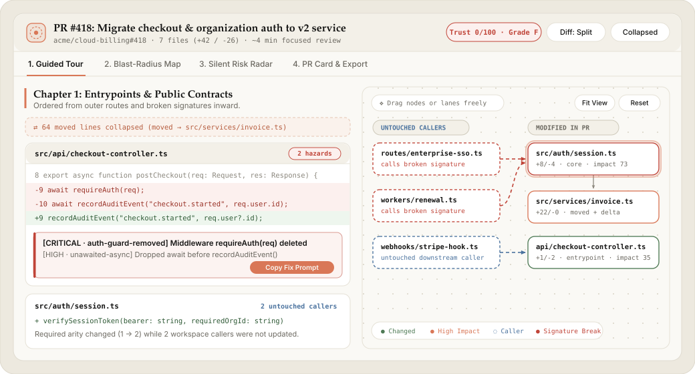

<div align="center">

<picture>
  <source media="(prefers-color-scheme: dark)" srcset="docs/media/logo-dark.svg">
  
</picture>

### GitHub diffs list changed files alphabetically. DiffXray shows what actually broke downstream.

Turn any local `git diff`, branch, or 40-file AI-generated Pull Request into an **interactive Blast-Radius Map**, **collapsed code-move tour**, and **"Quietly Wrong" silent-bug audit** — in under 1.5 seconds, with **zero dependencies** and **zero API keys**.

**English** · **[简体中文](README.zh-CN.md)** · **[Try Live Web Studio →](https://unbridled-41.github.io/diffxray/)** · **[Architecture](docs/ARCHITECTURE.md)**

[](https://github.com/unbridled-41/diffxray/actions/workflows/ci.yml)
[](#zero-dependency--privacy-architecture)
[](https://nodejs.org)
[](https://skills.sh)
[](#mcp-server-claude--cursor--codex)
[](LICENSE)

</div>

<p align="center">
  <a href="https://unbridled-41.github.io/diffxray/">
    
  </a>
</p>

<p align="center">
  <b><a href="https://unbridled-41.github.io/diffxray/">Open Live Browser Studio (No Install) →</a></b>
  &nbsp;·&nbsp;
  Paste any public GitHub PR URL (or open <a href="https://unbridled-41.github.io/diffxray/?pr=unbridled-41/diffxray/14"><code>?pr=owner/repo/123</code></a>) — 100% client-side.
</p>

---

## Why DiffXray?

Coding agents (Claude Code, Codex, Cursor, Antigravity) now generate 2,000-line, 30-file Pull Requests in minutes. Tests pass (`exit 0`), the diff compiles, and reviewers get stuck in cognitive overload because traditional diff viewers hide three things:

1. **Untouched Downstream Callers (The Hidden Blast Radius)**: When `verifySessionToken(token)` changes to `verifySessionToken(token, orgId)`, GitHub shows you `session.ts` — it **never** shows the 3 untouched routes and background workers that still call it with 1 argument.
2. **Mechanical Code Motion Mixed with Real Edits**: Moving a 120-line function into a new module while changing 1 discount constant looks like 240 lines of red/green churn. DiffXray pairs cross-file moves via normalized shingle Jaccard matching, collapses pure motion, and highlights **only the in-flight delta**.
3. **"Quietly Wrong" `exit 0` Regressions**: Agents routinely make failing suites turn green by adding `.skip`, deleting `expect()` assertions, wrapping errors in empty `catch {}` blocks, dropping `await`, widening types to `any`, or removing `requireAuth` middleware.

> **Dogfood proof**: On its very first run against our own [PR #13](https://github.com/unbridled-41/diffxray/pull/13), DiffXray's `silent-catch` detector caught a real JSON-RPC `-32700` parse-error swallowing bug in our MCP server before push.

---

## Quick Start (30 Seconds)

### 1. Run Locally on Any Git Repo (Zero Install via `npx`)

Requires **Node.js 20+**. Zero third-party `node_modules` are downloaded.

```bash
# X-ray uncommitted changes (or current branch vs main) right in your terminal
npx github:unbridled-41/diffxray

# Generate & open the single-file offline Interactive HTML Studio
npx github:unbridled-41/diffxray main...HEAD --html --open

# X-ray any GitHub Pull Request directly by number, slug, or URL
npx github:unbridled-41/diffxray --pr 14
npx github:unbridled-41/diffxray --pr vercel-labs/skills#10 --html --open

# Pre-commit / CI gate: exit 1 if any high or critical silent hazard is introduced
npx github:unbridled-41/diffxray --staged --fail-on high
```

### 2. Install as an Agent Skill (`Claude Code` · `Codex` · `Cursor` · `Antigravity` · `OpenCode`)

Teach your coding agent to verify its own blast radius and eliminate silent regressions *before* finishing a task or opening a PR:

```bash
npx skills add unbridled-41/diffxray
```

Or install as a native **Claude Code Plugin**:

```bash
claude plugin install diffxray --marketplace unbridled-41/diffxray
```

### 3. Add Sticky PR Review Maps via GitHub Actions (5 Lines)

Create `.github/workflows/diffxray.yml` to automatically post and update a Guided Reading Order + Blast-Radius + Risk Radar map on every Pull Request (see it live on [our own PRs](https://github.com/unbridled-41/diffxray/pulls?q=is%3Apr)):

```yaml
name: DiffXray PR Review
on: [pull_request]
permissions:
  contents: read
  pull-requests: write
jobs:
  xray:
    runs-on: ubuntu-latest
    steps:
      - uses: actions/checkout@v4
        with:
          fetch-depth: 0
      - uses: unbridled-41/diffxray@main
```

---

## Exportable Adaptive SVG PR Cards

Run `npx github:unbridled-41/diffxray --svg diffxray-card.svg` (or click **Tab 4: PR Card & Export** in the HTML Studio) to generate a `prefers-color-scheme` vector card for PR descriptions, architecture reviews, and Slack threads:

<p align="center">
  
</p>

---

## What the 12 "Quietly Wrong" Detectors Catch

Every rule is **100% deterministic** (zero LLM hallucinations, `<50ms` execution, OASIS **SARIF v2.1.0** compatible via `--sarif`):

| Rule ID | Severity | What It Catches |
| --- | --- | --- |
| `secret-leak` | **Critical** | Newly added AWS, GitHub, OpenAI/Anthropic/Stripe keys, Slack tokens, private keys, or DB passwords (masked in output). |
| `injection-risk` | **Critical** | Interpolated SQL template/f-strings, `eval` / `new Function`, `shell: true` command execution, `dangerouslySetInnerHTML`. |
| `auth-guard-removed` | **Critical** | Deleted authentication/authorization middleware or decorators (`requireAuth`, `verifyToken`, `@UseGuards`, `@login_required`) without replacement. |
| `breaking-signature` | **High** | Exported function required-param increase, arity reduction, or `async` flip cross-referenced against **untouched workspace callers**. |
| `weakened-test` | **High** | Added `.skip` / `.only` / `@pytest.mark.skip` or deleted `expect()` / `assert` calls without replacement assertions. |
| `silent-catch` | **High** | Newly added empty or comment-only `catch {}` / `except: pass` blocks that swallow runtime failures. |
| `unawaited-async` | **High** | Dropped `await` before async calls inside modified hunks, creating fire-and-forget race conditions. |
| `type-erosion` | **Medium** | Newly injected `: any`, `as any`, `@ts-ignore`, `# type: ignore`, or `unsafe {}` escape hatches in production code. |
| `schema-drift` | **Medium** | Prisma / SQL / ORM model files modified without a corresponding migration file in the diff. |
| `untested-core` | **Medium** | `>= 30` effective lines modified in `core`, `entrypoint`, or `data` layers with `0` test files updated. |
| `lockfile-drift` | **Low** | Package manifest dependency blocks modified without updating the corresponding lockfile. |
| `debug-leftover` | **Low** | Leftover `debugger`, `console.log`, `pdb.set_trace()`, `breakpoint()`, or `dbg!()` in non-CLI production modules. |

---

## Multi-Language Support

Symbol extraction, signature-break diffing, and module import resolution work out-of-the-box across:
- **TypeScript & JavaScript** (`.ts`, `.tsx`, `.mts`, `.js`, `.jsx`, `.mjs`, `.cjs`)
- **Python** (`.py`)
- **Go** (`.go`)
- **Rust** (`.rs`)
- **Java, Kotlin & C#** (`.java`, `.kt`, `.cs`)
- **SQL & Prisma Schemas** (`.sql`, `.prisma`)

---

## MCP Server (`Claude Desktop` · `Claude Code` · `Cursor` · `Codex`)

DiffXray includes a built-in, zero-dependency JSON-RPC 2.0 STDIO **Model Context Protocol** server exposing `xray_git_diff`, `xray_github_pr`, and `audit_silent_hazards`:

```json
{
  "mcpServers": {
    "diffxray": {
      "command": "npx",
      "args": ["-y", "github:unbridled-41/diffxray", "--mcp"]
    }
  }
}
```

---

## How DiffXray Compares

| Capability | GitHub PR UI | SaaS PR Bots ($15–30/mo) | Static Repo Maps (`floorplan`) | **DiffXray** |
| --- | --- | --- | --- | --- |
| **Cost & License** | Free | Paid per seat | MIT | **Free · MIT** |
| **Works on uncommitted local edits** | No | No | Static files only | **Yes (`< 1.5s`)** |
| **Zero API keys / Zero telemetry** | N/A | Cloud LLM required | LLM plugin | **100% deterministic & local** |
| **Untouched downstream caller Blast Radius** | No | Partial | Static | **Yes (interactive graph)** |
| **Cross-file moved code collapsing + delta** | File rename only | No | N/A | **Yes (shingle Jaccard)** |
| **Zero-install browser URL PR X-Ray** | Alphabetical list | No | Static demo | **Yes (`?pr=owner/repo/123`)** |
| **Runtime `node_modules` dependencies** | N/A | Heavy | **0** | **0** |

---

## Zero-Dependency & Privacy Architecture

- **Zero Supply-Chain Bloat**: `package.json` ships with `"dependencies": {}`. `scripts/verify-integrity.mjs` enforces zero runtime dependencies and strict browser/Node ESM isomorphism on every CI run across Linux, macOS, and Windows.
- **100% Private**: Neither the CLI nor the offline HTML Studio ever transmits code or telemetry. Network calls happen only when *you* explicitly pass `--pr` to fetch a GitHub Pull Request.

---

## Contributing & License

Contributions, new language symbol patterns, and low-noise risk detectors are welcome! See [CONTRIBUTING.md](CONTRIBUTING.md) and [docs/ARCHITECTURE.md](docs/ARCHITECTURE.md).

Released under the [MIT License](LICENSE).
