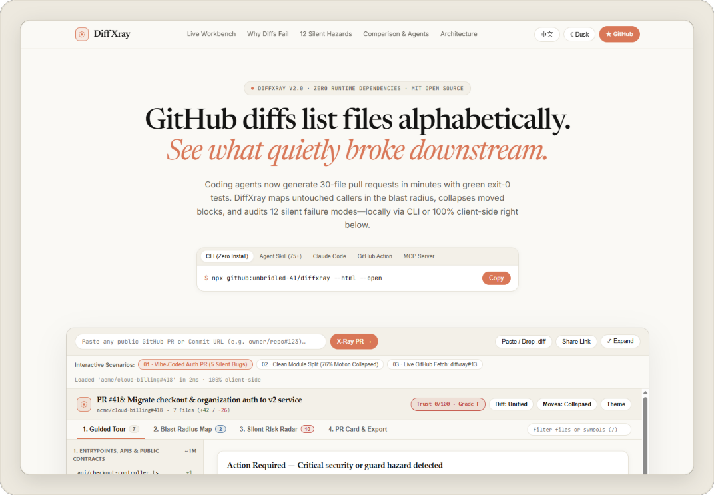
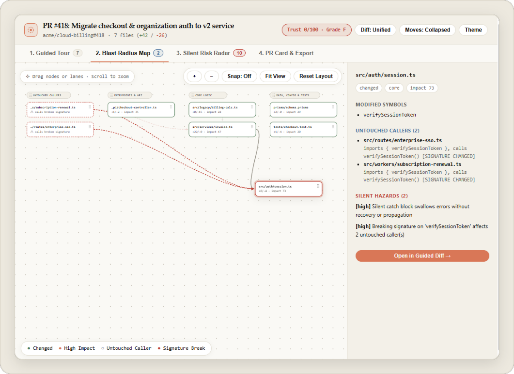

<p align="left">
  <picture>
    <source media="(prefers-color-scheme: dark)" srcset="docs/media/logo-dark.svg">
    
  </picture>
</p>

# Read architecture, not alphabetical diffs.

DiffXray turns local `git diff` changes and large Pull Requests into an interactive **Blast-Radius Map**, a **cross-file moved-code tour**, and a deterministic **12-rule silent-regression audit**. It runs locally on Node.js 20+ or 100% client-side in the browser, with zero runtime `node_modules` and zero API keys.

**[Live Web Studio](https://unbridled-41.github.io/diffxray/)** · **[Quick Start](#quick-start)** · **[12 Hazard Rules](#deterministic-hazard-rules)** · **[MCP & Agent Skill](#agent-skill--mcp-server)** · **[Architecture](docs/ARCHITECTURE.md)** · **[简体中文](README.zh-CN.md)**

<p>
  <a href="https://unbridled-41.github.io/diffxray/">
    
  </a>
</p>

---

## Why DiffXray Exists

Coding agents routinely touch 25 to 40 files in a single Pull Request while keeping tests green (`exit 0`). Reviewing those changes in an alphabetical file list hides three structural problems:

1. **Untouched downstream callers.** When `verifySessionToken(token)` adds a required second parameter `orgId`, GitHub shows `session.ts`—never the untouched routes and background workers in your repository that still call it with one argument.
2. **Code motion mixed with behavioral edits.** Extracting a 120-line billing helper into a new module while changing one discount constant looks like 240 lines of red and green churn. DiffXray pairs cross-file moves with normalized shingle Jaccard matching, collapses pure motion, and highlights only the modified line.
3. **Silent `exit 0` regressions.** Suites often stay green because a patch added `.skip`, deleted an `expect()` assertion, swallowed an exception inside an empty `catch {}` block, dropped `await`, or removed an auth middleware guard.

> On its first self-check against [PR #13](https://github.com/unbridled-41/diffxray/pull/13), DiffXray's `silent-catch` rule caught a real JSON-RPC `-32700` parse-error bug in its own MCP server before push.

---

## Interactive Blast-Radius Canvas

Every report renders as a single-file offline HTML Studio (or runs directly at **[unbridled-41.github.io/diffxray](https://unbridled-41.github.io/diffxray/)**). Module cards and swimlane headers can be dragged freely across the canvas while dependency curves re-route across ports in real time:

<p>
  <a href="https://unbridled-41.github.io/diffxray/">
    
  </a>
</p>

- **Guided Review Tour** orders files from outer public contracts and entrypoints inward (`Entrypoints` → `Core Domain` → `Data & Config` → `UI` → `Tests`), with Unified and Side-by-Side Split diff modes (`s`).
- **Draggable Blast-Radius Map** separates modified modules from untouched workspace callers hit by signature breaks, with cursor-centered wheel zoom, `12px` grid snapping, and non-destructive `Fit View` / `Reset Layout`.
- **Client-Side URL Deep Links** let you inspect any public GitHub Pull Request or commit directly via `?pr=owner/repo/123` without installing anything.

---

## Quick Start

Requires **Node.js 20+**. Nothing is uploaded; third-party runtime dependencies are `0`.

```bash
# X-ray uncommitted or branch changes in the terminal
npx github:unbridled-41/diffxray

# Generate and open the standalone Interactive HTML Studio
npx github:unbridled-41/diffxray main...HEAD --html --open

# Inspect any GitHub Pull Request by number, slug, or URL
npx github:unbridled-41/diffxray --pr vercel-labs/skills#10 --html --open

# CI or pre-commit gate: exit 1 if high or critical silent hazards are introduced
npx github:unbridled-41/diffxray --staged --fail-on high

# Install a zero-Husky local .git/hooks/pre-push safety gate
npx github:unbridled-41/diffxray --install-hook
```

---

## Agent Skill, MCP Server & GitHub Action

### 1. Agent Skill (`Claude Code` · `Codex` · `Cursor` · `Antigravity` · `OpenCode`)

Install `SKILL.md` so coding agents audit their own blast radius and silent hazards before opening a PR:

```bash
npx skills add unbridled-41/diffxray
```

Or install as a Claude Code plugin:

```bash
claude plugin install diffxray --marketplace unbridled-41/diffxray
```

### 2. Model Context Protocol (STDIO MCP Server)

Exposes `xray_git_diff`, `xray_patch_text`, and `xray_github_pr` over standard JSON-RPC 2.0 STDIO:

```json
{
  "mcpServers": {
    "diffxray": {
      "command": "npx",
      "args": ["-y", "github:unbridled-41/diffxray", "--mcp"]
    }
  }
}
```

### 3. GitHub Action (Sticky PR Architecture Comment + SARIF)

Add `.github/workflows/diffxray.yml` to post and update a Guided Reading Order + Blast-Radius summary on every Pull Request:

```yaml
name: DiffXray PR Review
on: [pull_request]
permissions:
  contents: read
  pull-requests: write
jobs:
  xray:
    runs-on: ubuntu-latest
    steps:
      - uses: actions/checkout@v4
        with:
          fetch-depth: 0
      - uses: unbridled-41/diffxray@main
```

---

## Exportable Vector PR Cards

Run `npx github:unbridled-41/diffxray --svg diffxray-card.svg` (or open **Tab 4: PR Card & Export** in the Studio) to export a standalone SVG summary card for Pull Request descriptions and design docs:

<p>
  
</p>

---

## Deterministic Hazard Rules

All 12 detectors use deterministic static and symbol-graph heuristics (`< 50ms` typical runtime, zero LLM prompt variance, OASIS **SARIF v2.1.0** output via `--sarif <path>`, configurable via `.diffxray.json`):

| Rule ID | Severity | What It Detects |
| --- | --- | --- |
| `secret-leak` | Critical | Newly added AWS, GitHub, OpenAI/Anthropic/Stripe keys, Slack tokens, private keys, or DB URI credentials (masked in output). |
| `injection-risk` | Critical | Interpolated SQL template/f-strings, `eval` / `new Function`, `shell: true` command execution, and unescaped HTML sinks. |
| `auth-guard-removed` | Critical | Removed authentication or permission middleware (`requireAuth`, `verifyToken`, `@UseGuards`, `@login_required`) without replacement. |
| `breaking-signature` | High | Exported function required-parameter increase, arity reduction, or `async` contract change affecting untouched workspace callers. |
| `weakened-test` | High | Added `.skip` / `.only` / `@pytest.mark.skip` or deleted `expect()` / `assert` checks without replacement assertions. |
| `silent-catch` | High | Newly added empty or comment-only `catch {}` / `except: pass` blocks that swallow runtime errors. |
| `unawaited-async` | High | Dropped `await` before async calls inside modified hunks. |
| `type-erosion` | Medium | Newly introduced `: any`, `as any`, `@ts-ignore`, `# type: ignore`, or `unsafe {}` blocks in production modules. |
| `schema-drift` | Medium | Prisma, SQL, or ORM schema edits without a corresponding migration file in the diff. |
| `untested-core` | Medium | `>= 30` effective lines changed in `core`, `entrypoint`, or `data` modules with `0` test files updated. |
| `lockfile-drift` | Low | Package manifest dependency edits without updating the lockfile. |
| `debug-leftover` | Low | Leftover `debugger`, `console.log`, `pdb.set_trace()`, `breakpoint()`, or `dbg!()` statements in non-CLI code. |

---

## Supported Languages & Architecture

- **Languages**: TypeScript / JavaScript (`.ts`, `.tsx`, `.mts`, `.js`, `.jsx`, `.mjs`, `.cjs`), Python (`.py`), Go (`.go`), Rust (`.rs`), Java / Kotlin / C# (`.java`, `.kt`, `.cs`), SQL & Prisma (`.sql`, `.prisma`).
- **Zero-Dependency Isomorphic Core**: `src/core/`, `src/analyzers/`, and `src/renderers/` import zero `node:*` modules and zero npm packages—the exact same ES modules run in the Node CLI, GitHub Action, MCP server, and browser Studio. Verified on Ubuntu, macOS, and Windows in CI.

## License

[MIT](LICENSE) · Contributions welcome — see [CONTRIBUTING.md](CONTRIBUTING.md) and [docs/ARCHITECTURE.md](docs/ARCHITECTURE.md).
