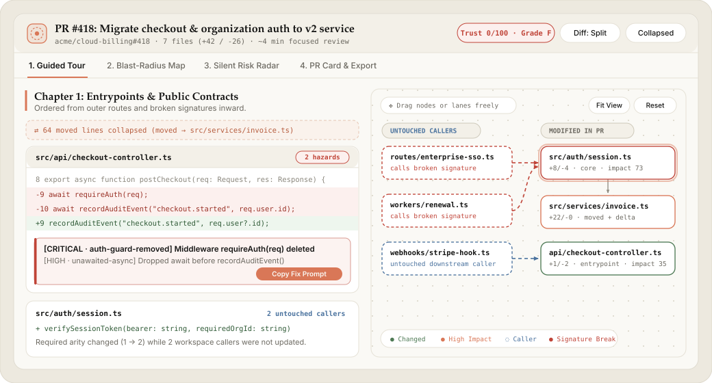

<div align="center">

<picture>
  <source media="(prefers-color-scheme: dark)" srcset="docs/media/logo-dark.svg">
  
</picture>

### GitHub Diff 只按字母顺序展示改了哪些文件；DiffXray 透视真正受波及的下游调用链与隐蔽故障。

1.5 秒内把任意本地 `git diff`、分支或 AI 生成的几十文件巨型 PR，转化为**交互式爆炸半径图（Blast-Radius Map）**、**跨文件代码搬运折叠导览**与 **12 项「静默错误」雷达审计** —— **零外部依赖 · 零 API Key · 100% 本地或纯浏览器运行**。

**[English](README.md)** · **简体中文** · **[在线体验 Live Studio（免安装）→](https://unbridled-41.github.io/diffxray/)** · **[架构文档](docs/ARCHITECTURE.md)**

[](https://github.com/unbridled-41/diffxray/actions/workflows/ci.yml)
[](#零依赖与隐私安全架构)
[](https://nodejs.org)
[](https://skills.sh)
[](#mcp-服务接入claude--cursor--codex)
[](LICENSE)

</div>

<p align="center">
  <a href="https://unbridled-41.github.io/diffxray/">
    
  </a>
</p>

<p align="center">
  <b><a href="https://unbridled-41.github.io/diffxray/">立即打开浏览器端在线透视台（无需安装）→</a></b>
  &nbsp;·&nbsp;
  粘贴任意公开 GitHub PR 链接（或直接访问 <a href="https://unbridled-41.github.io/diffxray/?pr=unbridled-41/diffxray/14"><code>?pr=owner/repo/123</code></a>），纯前端运行。
</p>

---

## 为什么需要 DiffXray？

在 Claude Code、Codex、Cursor、Antigravity 等编码智能体普及之后，几分钟生成跨越 30 个文件、2000 行改动的 PR 已成日常。单测全绿（`exit 0`）、编译通过，但人工 Code Review 却彻底陷入疲劳，因为传统 Diff 视图天然隐藏了三件最致命的事：

1. **未被修改却被波及的下游调用方（隐藏爆炸半径）**：当 `verifySessionToken(token)` 被改成需要两个参数 `verifySessionToken(token, orgId)` 时，GitHub 只展示 `session.ts`，**绝不会提醒你仓库里还有 3 个没在 Diff 里出现的路由和后台任务仍在传 1 个参数**。
2. **机械式代码搬运掩盖了真实逻辑微调**：把 120 行函数抽离到新文件顺手改了 1 个折扣系数，在 Git 里会变成 240 行红绿刷屏。DiffXray 通过归一化 Shingle Jaccard 算法配对跨文件搬运块，自动折叠纯移动代码，**精准高亮搬运途中被顺手修改的那几行**。
3. **「静默错误」（Quietly Wrong `exit 0`）**：AI Agent 常为了让报错测试变绿而悄悄加上 `.skip`、删掉 `expect()` 断言、套一层空 `catch {}` 吞掉异常、漏写 `await`、把类型改成 `any`，甚至误删 `requireAuth` 鉴权守卫。

> **真实自举验证**：在我们自己的 [PR #13](https://github.com/unbridled-41/diffxray/pull/13) 提交前首次运行 `diffxray --staged` 时，`silent-catch` 规则当场抓出了我们 MCP Server 中吞掉 JSON-RPC `-32700` 解析错误的真实缺陷。

---

## 30 秒快速上手

### 1. 本地仓库一键运行（零依赖 `npx`）

仅需 **Node.js 20+**，无需安装任何第三方 `node_modules`：

```bash
# 直接在终端透视当前未提交改动（自动扫描全仓未修改的下游调用链）
npx github:unbridled-41/diffxray

# 生成并自动在浏览器打开单文件离线交互式 HTML 透视台
npx github:unbridled-41/diffxray main...HEAD --html --open

# 直接透视任意 GitHub PR（支持编号、owner/repo#编号 或完整链接）
npx github:unbridled-41/diffxray --pr 14
npx github:unbridled-41/diffxray --pr vercel-labs/skills#10 --html --open

# Pre-commit / CI 门禁：一旦发现高危或严重静默风险则返回非零退出码
npx github:unbridled-41/diffxray --staged --fail-on high
```

### 2. 安装为编码智能体 Skill（支持 `Claude Code` · `Codex` · `Cursor` · `Antigravity` 等 75+ 工具）

让你的 AI 编码助手在交活或提 PR 前，主动自查下游爆炸半径并修复静默隐患：

```bash
npx skills add unbridled-41/diffxray
```

或在 **Claude Code** 中作为原生插件安装：

```bash
claude plugin install diffxray --marketplace unbridled-41/diffxray
```

### 3. 5 行配置接入 GitHub Actions 自动 PR 导览卡片

新建 `.github/workflows/diffxray.yml`，每次提交或更新 PR 时自动生成并原地刷新包含「推荐阅读顺序 + 下游爆炸半径 + 风险雷达」的导览评论（可在[本仓库 PR 列表](https://github.com/unbridled-41/diffxray/pulls?q=is%3Apr)查看真实运行效果）：

```yaml
name: DiffXray PR Review
on: [pull_request]
permissions:
  contents: read
  pull-requests: write
jobs:
  xray:
    runs-on: ubuntu-latest
    steps:
      - uses: actions/checkout@v4
        with:
          fetch-depth: 0
      - uses: unbridled-41/diffxray@main
```

---

## 自适应深浅色 SVG 架构透视卡

运行 `npx github:unbridled-41/diffxray --svg diffxray-card.svg` 即可导出自适应 GitHub 深色/浅色主题的矢量透视卡，直接嵌入 PR 描述或技术评审文档：

<p align="center">
  
</p>

---

## 12 项确定性「静默故障」检测规则

所有规则均为**纯确定性静态与图谱分析**（无大模型幻觉、毫秒级响应、支持 `--sarif` 导出接入 GitHub Code Scanning）：

| 规则 ID | 等级 | 检测内容 |
| --- | --- | --- |
| `secret-leak` | **Critical** | 新增硬编码密钥（AWS、GitHub、OpenAI/Anthropic/Stripe、Slack、私钥、数据库密码，输出自动脱敏）。 |
| `injection-risk` | **Critical** | SQL 模板字符串拼接、`eval`/`new Function`、`shell: true` 命令注入风险、`dangerouslySetInnerHTML`。 |
| `auth-guard-removed` | **Critical** | 删除了 `requireAuth`、`verifyToken`、`@UseGuards`、`@login_required` 等鉴权守卫且无替代实现。 |
| `breaking-signature` | **High** | 导出函数必填参数增加、参数减少或 `async` 契约翻转，并关联标记**未同步修改的下游调用文件**。 |
| `weakened-test` | **High** | 新增 `.skip` / `.only` 跳过测试，或删除了 `expect()` / `assert` 断言却未补充新断言。 |
| `silent-catch` | **High** | 新增空 `catch {}`、仅含注释的 `catch` 或 Python `except: pass` 静默吞异常。 |
| `unawaited-async` | **High** | 修改块中丢失了异步调用前的 `await`，导致隐蔽竞态或未捕获拒绝。 |
| `type-erosion` | **Medium** | 生产代码新增 `: any`、`as any`、`@ts-ignore`、`# type: ignore` 或 Rust `unsafe {}`。 |
| `schema-drift` | **Medium** | 修改了 Prisma / SQL / ORM 数据模型，但 Diff 中缺少对应的数据库迁移文件。 |
| `untested-core` | **Medium** | 核心业务/接口/数据层有效改动超过 30 行，但整个 Diff 未更新任何测试文件。 |
| `lockfile-drift` | **Low** | 修改了包管理清单依赖项，但未同步更新锁文件。 |
| `debug-leftover` | **Low** | 生产模块残留 `debugger`、`console.log`、`pdb.set_trace()` 或 `dbg!()`。 |

---

## MCP 服务接入（`Claude Desktop` · `Claude Code` · `Cursor` · `Codex`）

内置零依赖 JSON-RPC 2.0 STDIO **MCP Server**，提供 `xray_git_diff`、`xray_github_pr` 与 `audit_silent_hazards` 三个原生工具：

```json
{
  "mcpServers": {
    "diffxray": {
      "command": "npx",
      "args": ["-y", "github:unbridled-41/diffxray", "--mcp"]
    }
  }
}
```

---

## 零依赖与隐私安全架构

- **零供应链膨胀**：`package.json` 运行时依赖严格为 `0`。每次跨平台 CI（Linux / macOS / Windows）均通过 `scripts/verify-integrity.mjs` 强制校验零依赖与前后端同构边界。
- **100% 本地隐私**：CLI、MCP 与离线 HTML 报告均在本地完成计算，零遥测、零代码上传；在线版纯浏览器内存解析。

---

## 参与贡献与开源协议

欢迎提交 Issue 与 PR 扩展更多语言符号解析器或低噪检测规则！详见 [CONTRIBUTING.md](CONTRIBUTING.md) 与 [docs/ARCHITECTURE.md](docs/ARCHITECTURE.md)。

本项目基于 [MIT License](LICENSE) 开源发布。
