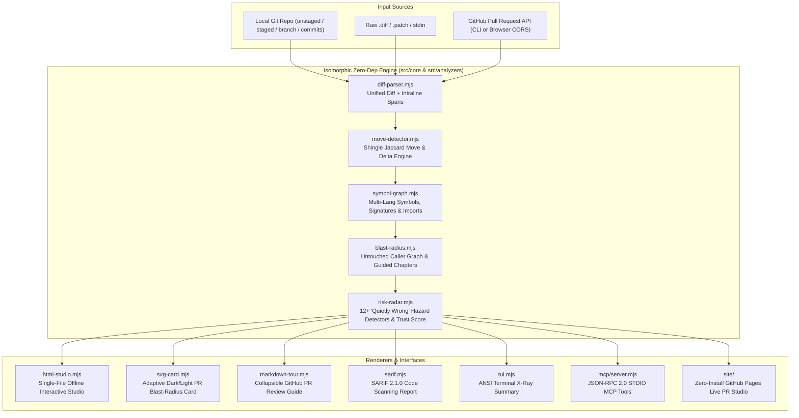

# DiffXray System Architecture

## 1. Architectural Overview

DiffXray is engineered around a **strictly isomorphic, zero-dependency core** (`src/core/` and `src/analyzers/`) shared identically between the **Node.js CLI / MCP Server / GitHub Action** and the **100% client-side Browser Web Studio**.

---

## 2. Module Responsibilities & Contracts

### `src/core/` (Pure ESM, Browser + Node Compatible)
- **`diff-parser.mjs`**: Parses unified diffs into normalized `DiffFile[]` structures with `status` (`added | modified | deleted | renamed | binary`), `hunks[]`, old/new line numbers, and intraline character-level change spans.
- **`move-detector.mjs`**: Computes normalized token/line shingles across removed blocks and added blocks across files. Pairs moved functions/blocks (`similarity >= 0.75`, `minLines >= 4`), marks mechanical moves so reviewers can skip them, and pinpoints **in-flight modifications** inside moved code.
- **`symbol-graph.mjs`**: Extracts declared/modified symbols (functions, classes, hooks, routes, types, SQL tables), parameter signatures, and module import specifiers across TypeScript/JavaScript, Python, Go, Rust, Java/Kotlin, C/C++, Ruby, and SQL.
- **`blast-radius.mjs`**: Combines diff symbol changes with optional workspace file index (`WorkspaceFile[]` in Node CLI; cross-PR/repo tree in Web Studio) to resolve:
  1. **Direct Diff Edges** (changed file A imports changed file B)
  2. **Untouched Downstream Callers** (unchanged file C imports/calls modified symbol `fn` from changed file A — the hidden blast radius!)
  3. **Architectural Layer Classification** (`entrypoint`, `core`, `data`, `ui`, `config`, `test`, `docs`)
  4. **Guided Reading Chapters** (topological ordering from entrypoints & high-impact core down to leaf utilities, collapsing pure moves and lockfiles).

### `src/analyzers/`
- **`risk-radar.mjs`**: Runs 12 deterministic detectors over added/removed hunks and symbol graph edges (`silent-catch`, `weakened-test`, `unawaited-async`, `type-erosion`, `auth-guard-removed`, `secret-leak`, `breaking-signature`, `injection-risk`, `schema-drift`, `lockfile-drift`, `debug-leftover`, `untested-core`). Produces structured `RiskFinding[]`, `trustScore` (`0..100`), and `estimatedReviewMinutes`.

### `src/renderers/`
- **`html-studio.mjs`**: Emits a self-contained, XSS-hardened, zero-CDN offline HTML5 application with 4 views (Guided Story, Interactive SVG Blast-Radius Graph, Risk Radar, Export & Agent Fix Kit), theme switcher, and vim-style keyboard shortcuts.
- **`svg-card.mjs`**: Renders crisp `prefers-color-scheme` vector SVG cards for GitHub PR comments and READMEs.
- **`markdown-tour.mjs`**: Generates clean GitHub-Flavored Markdown PR walkthroughs.
- **`sarif.mjs`**: Exports OASIS SARIF v2.1.0 JSON for GitHub Security Code Scanning.
- **`tui.mjs`**: Renders colorized ANSI terminal X-Ray reports.

### `src/cli/` & `src/mcp/` (Node.js Built-ins Only)
- **`workspace-scanner.mjs`**: Fast `.gitignore`-aware repository scanner feeding untouched file imports/callsites into `blast-radius.mjs`.
- **`git-runner.mjs`**: Safe `execFileSync('git', ...)` wrapper (never invokes a shell, eliminating command injection) + GitHub PR API fetcher.
- **`mcp/server.mjs`**: Zero-dependency STDIO Model Context Protocol server implementing `initialize`, `tools/list`, and `tools/call`.
